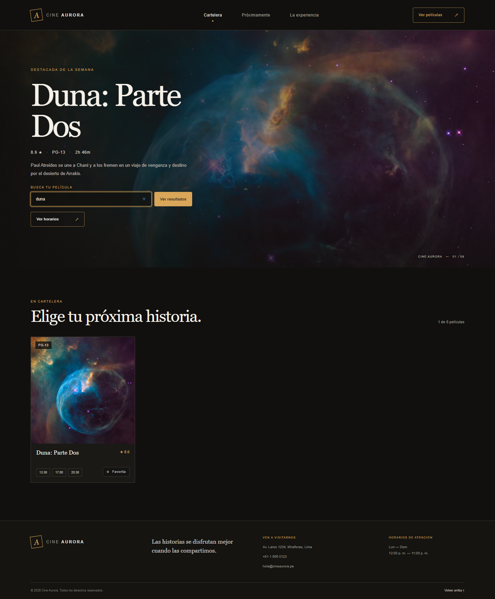
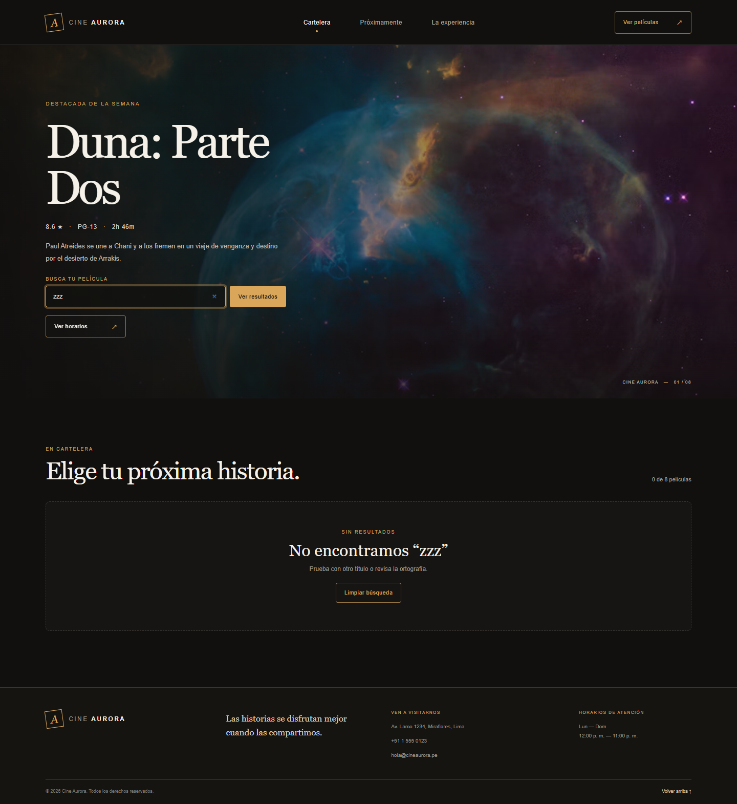
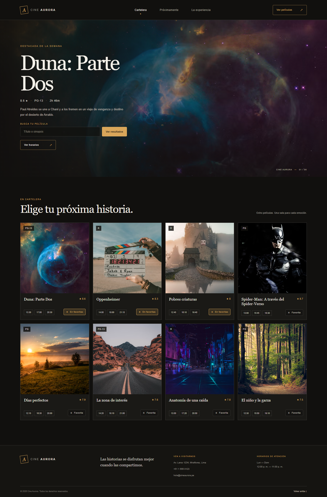
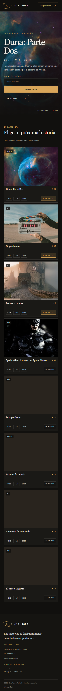
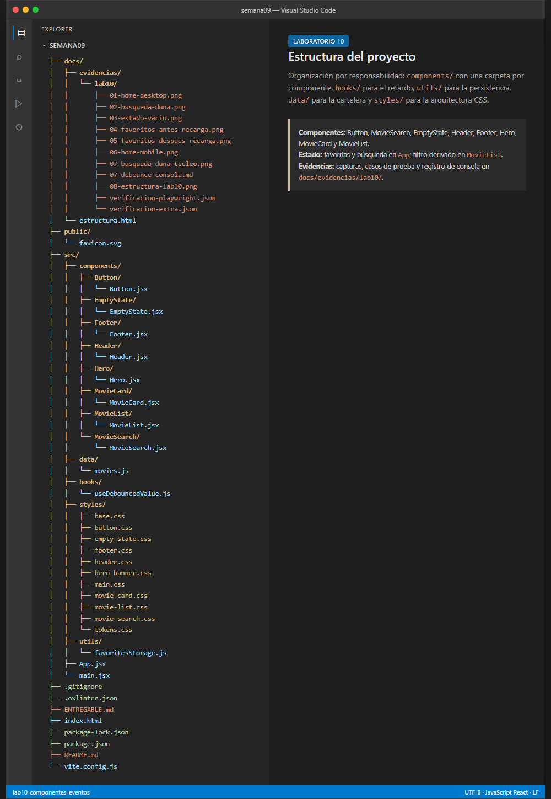

# Laboratorio 10 — Componentes y eventos

## 1. Datos del alumno

| Campo | Valor |
|---|---|
| Nombre | Michael Montgomery Rosell |
| Curso | Desarrollo de Aplicaciones Empresariales |
| Sección | 4-C24-A |
| Laboratorio | Semana 10 — Componentes y eventos |
| Repositorio | https://github.com/mayragarcia-dev/semana09.git |
| Rama de trabajo | `lab10-componentes-eventos` |
| Commit final | Consultar con `git log -1 --oneline` |

## 2. Título del desarrollo

**Cartelera “Cine Aurora”: componentes reutilizables, estado, eventos y búsqueda con retardo.**

## 3. Resumen del proyecto

La aplicación parte de la cartelera del Laboratorio 09 y añade los conceptos del Laboratorio 10:

- Un componente `Button` reutilizable que recibe su contenido por `children` y su aspecto por `variant`.
- Estado de películas favoritas en `App` y comunicación hacia arriba desde `MovieCard`.
- Un buscador controlado (`MovieSearch`) integrado en el banner.
- Retardo de 300 ms para que el filtrado no se dispare con cada letra.
- Filtrado de la cartelera por título o sinopsis y estado vacío cuando no hay coincidencias.
- Persistencia de las favoritas en `localStorage`.

**Tecnologías:** React 19, Vite 8, JavaScript (JSX), CSS por responsabilidad y Oxlint.

## 4. Capturas del resultado

### 4.1. Vista completa con el buscador en el banner


### 4.2. Búsqueda por título



### 4.3. Estado vacío del buscador



### 4.4. Favoritas antes y después de recargar




### 4.5. Vista móvil



## 5. Estructura del proyecto

```text
semana09/
├── docs/
│   └── evidencias/
│       └── lab10/
│           ├── 01-home-desktop.png
│           ├── 02-busqueda-duna.png
│           ├── 03-estado-vacio.png
│           ├── 04-favoritos-antes-recarga.png
│           ├── 05-favoritos-despues-recarga.png
│           ├── 06-home-mobile.png
│           ├── 07-busqueda-duna-tecleo.png
│           ├── 07-debounce-consola.md
│           ├── 08-estructura-lab10.png
│           ├── verificacion-playwright.json
│           └── verificacion-extra.json
├── public/
│   └── favicon.svg
├── src/
│   ├── components/
│   │   ├── Button/
│   │   │   └── Button.jsx
│   │   ├── EmptyState/
│   │   │   └── EmptyState.jsx
│   │   ├── Footer/
│   │   │   └── Footer.jsx
│   │   ├── Header/
│   │   │   └── Header.jsx
│   │   ├── Hero/
│   │   │   └── Hero.jsx
│   │   ├── MovieCard/
│   │   │   └── MovieCard.jsx
│   │   ├── MovieList/
│   │   │   └── MovieList.jsx
│   │   └── MovieSearch/
│   │       └── MovieSearch.jsx
│   ├── data/
│   │   └── movies.js
│   ├── hooks/
│   │   └── useDebouncedValue.js
│   ├── styles/
│   │   ├── base.css
│   │   ├── button.css
│   │   ├── empty-state.css
│   │   ├── footer.css
│   │   ├── header.css
│   │   ├── hero-banner.css
│   │   ├── main.css
│   │   ├── movie-card.css
│   │   ├── movie-list.css
│   │   ├── movie-search.css
│   │   └── tokens.css
│   ├── utils/
│   │   └── favoritesStorage.js
│   ├── App.jsx
│   └── main.jsx
├── ENTREGABLE.md
├── README.md
├── index.html
├── package.json
└── vite.config.js
```

La norma de **una carpeta por componente** se mantiene: `Button`, `EmptyState`, `MovieSearch`, `Header`, `Hero`, `MovieCard`, `MovieList` y `Footer` tienen su propia carpeta.



## 6. Código

### 6.1. Composición y estado — `src/App.jsx`

```jsx
import { useEffect, useState } from 'react'
import Header from './components/Header/Header.jsx'
import Footer from './components/Footer/Footer.jsx'
import Hero from './components/Hero/Hero.jsx'
import MovieList from './components/MovieList/MovieList.jsx'
import { movies } from './data/movies.js'
import { useDebouncedValue } from './hooks/useDebouncedValue.js'
import { loadFavorites, saveFavorites } from './utils/favoritesStorage.js'

export default function App() {
  const [favorites, setFavorites] = useState(loadFavorites)
  const [searchTerm, setSearchTerm] = useState('')
  const debouncedSearchTerm = useDebouncedValue(searchTerm, 300)

  useEffect(() => {
    saveFavorites(favorites)
  }, [favorites])

  const toggleFavorite = (movieId) => {
    setFavorites((current) =>
      current.includes(movieId)
        ? current.filter((id) => id !== movieId)
        : [...current, movieId],
    )
  }

  const handleSearchChange = (value) => {
    if (import.meta.env.DEV) {
      console.log('[search] keystroke:', value)
    }
    setSearchTerm(value)
  }

  const handleSearchSubmit = (event) => {
    event.preventDefault()
    document.getElementById('peliculas')?.scrollIntoView({ behavior: 'smooth' })
  }

  const handleClearSearch = () => {
    setSearchTerm('')
  }

  return (
    <div className="page-shell" id="inicio">
      <Header />
      <main>
        <Hero
          movie={movies[0]}
          searchTerm={searchTerm}
          onSearchChange={handleSearchChange}
          onSearchSubmit={handleSearchSubmit}
        />
        <MovieList
          movies={movies}
          searchTerm={debouncedSearchTerm}
          favorites={favorites}
          onToggleFavorite={toggleFavorite}
          onClearSearch={handleClearSearch}
        />
      </main>
      <Footer />
    </div>
  )
}
```

### 6.2. Componente reutilizable — `src/components/Button/Button.jsx`

```jsx
import '../../styles/button.css'

export default function Button({
  children,
  variant = 'primary',
  size = 'md',
  href,
  type = 'button',
  className = '',
  ...rest
}) {
  const classes = ['button', `button--${variant}`, `button--${size}`, className]
    .filter(Boolean)
    .join(' ')

  if (href) {
    return (
      <a className={classes} href={href} {...rest}>
        {children}
      </a>
    )
  }

  return (
    <button className={classes} type={type} {...rest}>
      {children}
    </button>
  )
}
```

El mismo componente se usa en:

- `Header`: variante `ghost`.
- `Hero`: variante `ghost` para “Ver horarios”.
- `MovieSearch`: variante `primary` para “Ver resultados”.
- `MovieCard`: variantes `favorite` y `favoriteActive`.
- `EmptyState`: variante `ghost` para “Limpiar búsqueda”.

### 6.3. Buscador controlado — `src/components/MovieSearch/MovieSearch.jsx`

```jsx
import Button from '../Button/Button.jsx'
import '../../styles/movie-search.css'

export default function MovieSearch({ value, onChange, onSubmit }) {
  return (
    <form className="movie-search" role="search" onSubmit={onSubmit}>
      <label className="movie-search__label" htmlFor="movie-search-input">
        Busca tu película
      </label>
      <div className="movie-search__controls">
        <input
          id="movie-search-input"
          className="movie-search__input"
          type="search"
          value={value}
          onChange={(event) => onChange(event.target.value)}
          placeholder="Título o sinopsis"
          autoComplete="off"
        />
        <Button type="submit" variant="primary">
          Ver resultados
        </Button>
      </div>
    </form>
  )
}
```

### 6.4. Retardo del buscador — `src/hooks/useDebouncedValue.js`

```js
import { useEffect, useState } from 'react'

export function useDebouncedValue(value, delay = 300) {
  const [debouncedValue, setDebouncedValue] = useState(value)

  useEffect(() => {
    const timer = window.setTimeout(() => {
      setDebouncedValue(value)
    }, delay)

    return () => window.clearTimeout(timer)
  }, [value, delay])

  return debouncedValue
}
```

### 6.5. Persistencia — `src/utils/favoritesStorage.js`

```js
const STORAGE_KEY = 'cine-aurora:favorites'

export function loadFavorites() {
  try {
    const stored = window.localStorage.getItem(STORAGE_KEY)
    if (!stored) return []

    const parsed = JSON.parse(stored)
    if (!Array.isArray(parsed)) return []

    return parsed.filter((id) => typeof id === 'string')
  } catch {
    return []
  }
}

export function saveFavorites(favorites) {
  try {
    window.localStorage.setItem(STORAGE_KEY, JSON.stringify(favorites))
  } catch {
    // Storage can be unavailable (private mode or quota); keep working in memory.
  }
}
```

### 6.6. Filtrado y estado vacío — `src/components/MovieList/MovieList.jsx`

```jsx
import { useEffect, useMemo } from 'react'
import MovieCard from '../MovieCard/MovieCard.jsx'
import EmptyState from '../EmptyState/EmptyState.jsx'
import '../../styles/movie-list.css'

const normalize = (text) =>
  text
    .normalize('NFD')
    .replace(/[\u0300-\u036f]/g, '')
    .toLowerCase()

export default function MovieList({
  movies,
  searchTerm = '',
  favorites = [],
  onToggleFavorite,
  onClearSearch,
}) {
  const filteredMovies = useMemo(() => {
    const query = normalize(searchTerm.trim())
    if (!query) return movies

    return movies.filter((movie) => {
      const title = normalize(movie.title)
      const synopsis = normalize(movie.synopsis)
      return title.includes(query) || synopsis.includes(query)
    })
  }, [movies, searchTerm])

  useEffect(() => {
    if (import.meta.env.DEV && searchTerm) {
      console.log(`[filter] applied for "${searchTerm}" → ${filteredMovies.length} result(s)`)
    }
  }, [searchTerm, filteredMovies.length])

  const hasResults = filteredMovies.length > 0
  const hasQuery = searchTerm.trim().length > 0

  return (
    <section className="movie-list-section" id="peliculas" aria-labelledby="movies-title">
      <div className="movie-list-section__intro">
        <div>
          <p className="movie-list-section__eyebrow">EN CARTELERA</p>
          <h2 id="movies-title">Elige tu próxima historia.</h2>
        </div>
        <p className="movie-list-section__note" aria-live="polite">
          {hasQuery
            ? `${filteredMovies.length} de ${movies.length} películas`
            : 'Ocho películas. Una sala para cada emoción.'}
        </p>
      </div>
      {hasResults ? (
        <div className="movie-list">
          {filteredMovies.map((movie) => (
            <MovieCard
              movie={movie}
              key={movie.id}
              isFavorite={favorites.includes(movie.id)}
              onToggleFavorite={onToggleFavorite}
            />
          ))}
        </div>
      ) : (
        <EmptyState query={searchTerm.trim()} onClear={onClearSearch} />
      )}
    </section>
  )
}
```

### 6.7. Tarjeta con favorita — `src/components/MovieCard/MovieCard.jsx`

```jsx
import Button from '../Button/Button.jsx'
import '../../styles/movie-card.css'

export default function MovieCard({ movie, isFavorite = false, onToggleFavorite }) {
  return (
    <article className="movie-card">
      <div className="movie-card__poster-wrap">
        
        <span className="movie-card__classification">{movie.classification}</span>
      </div>
      <div className="movie-card__body">
        <div className="movie-card__heading">
          <h3>{movie.title}</h3>
          <span className="movie-card__rating" aria-label={`Valoración ${movie.rating} de 10`}>★ {movie.rating}</span>
        </div>
        <div className="movie-card__footer">
          <div className="movie-card__times" aria-label="Horarios disponibles">
            {movie.schedules.map((time) => <span className="movie-card__time" key={`${movie.id}-${time}`}>{time}</span>)}
          </div>
          <Button
            className="movie-card__favorite"
            variant={isFavorite ? 'favoriteActive' : 'favorite'}
            size="sm"
            aria-pressed={isFavorite}
            onClick={() => onToggleFavorite(movie.id)}
          >
            <span aria-hidden="true">{isFavorite ? '★' : '☆'}</span>
            {isFavorite ? 'En favoritas' : 'Favorita'}
          </Button>
        </div>
      </div>
    </article>
  )
}
```

### 6.8. Banner con buscador — `src/components/Hero/Hero.jsx`

```jsx
import Button from '../Button/Button.jsx'
import MovieSearch from '../MovieSearch/MovieSearch.jsx'
import '../../styles/hero-banner.css'

export default function Hero({ movie, searchTerm, onSearchChange, onSearchSubmit }) {
  if (!movie) return null

  return (
    <section className="featured-hero" id="cartelera" aria-labelledby="featured-title">
      
      <div className="featured-hero__shade" />
      <div className="featured-hero__content">
        <p className="featured-hero__eyebrow">DESTACADA DE LA SEMANA</p>
        <h1 id="featured-title">{movie.title}</h1>
        <p className="featured-hero__meta">{movie.rating} ★ <span>·</span> {movie.classification} <span>·</span> {movie.duration}</p>
        <p className="featured-hero__synopsis">{movie.synopsis}</p>
        <MovieSearch
          value={searchTerm}
          onChange={onSearchChange}
          onSubmit={onSearchSubmit}
        />
        <div className="featured-hero__actions">
          <Button className="featured-hero__button" href="#peliculas" variant="ghost">
            Ver horarios <span aria-hidden="true">↗</span>
          </Button>
        </div>
      </div>
      <span className="featured-hero__index">CINE AURORA <b>—</b> 01 / 08</span>
    </section>
  )
}
```

### 6.9. Estado vacío — `src/components/EmptyState/EmptyState.jsx`

```jsx
import Button from '../Button/Button.jsx'
import '../../styles/empty-state.css'

export default function EmptyState({ query, onClear }) {
  return (
    <div className="empty-state" role="status">
      <p className="empty-state__eyebrow">SIN RESULTADOS</p>
      <h3>No encontramos “{query}”</h3>
      <p className="empty-state__text">
        Prueba con otro título o revisa la ortografía.
      </p>
      <Button variant="ghost" onClick={onClear}>
        Limpiar búsqueda
      </Button>
    </div>
  )
}
```

### 6.10. Estilos base ampliados

`src/styles/base.css` incorpora el reset de formularios, el foco visible y utilidades:

```css
button, input, select, textarea { font: inherit; color: inherit; }
button { cursor: pointer; }
button:disabled { cursor: not-allowed; opacity: .55; }
:focus-visible { outline: 2px solid var(--color-accent); outline-offset: 3px; }

.sr-only { /* texto solo para lectores de pantalla */ }
.eyebrow { /* etiqueta superior reutilizable */ }
.text-muted { color: var(--color-muted); }
```

`src/styles/main.css` centraliza la carga:

```css
@import './tokens.css';
@import './base.css';
@import './button.css';
@import './header.css';
@import './hero-banner.css';
@import './movie-search.css';
@import './movie-card.css';
@import './movie-list.css';
@import './empty-state.css';
@import './footer.css';
```

## 7. Explicación del resultado

### 7.1. Composición de componentes

```text
App
├── Header
├── main
│   ├── Hero
│   │   └── MovieSearch
│   └── MovieList
│       ├── MovieCard
│       │   └── Button
│       └── EmptyState
│           └── Button
└── Footer
```

`App` es el orquestador y el dueño de los datos que se comparten. Los componentes hijos reciben props y notifican cambios mediante funciones; no importan `movies.js` ni modifican el estado del padre.

### 7.2. Componentes reutilizables

`Button` es el ejemplo principal de reutilización:

| Lugar | Variante | Contenido |
|---|---|---|
| Header | `ghost` | “Ver películas ↗” |
| Hero | `ghost` | “Ver horarios ↗” |
| MovieSearch | `primary` | “Ver resultados” |
| MovieCard | `favorite` / `favoriteActive` | “Favorita” / “En favoritas” |
| EmptyState | `ghost` | “Limpiar búsqueda” |

El contenido llega por `children` y el aspecto por `variant`; no se duplica el marcado ni los estilos de cada botón.

### 7.3. Dónde vive cada dato y por qué — punto 11

| Dato | Componente donde vive | Por qué se decidió así | Cómo se actualiza | ¿Se recuerda al recargar? |
|---|---|---|---|---|
| `favorites` | `App` | Es compartido por las ocho tarjetas y debe sobrevivir a la recarga. Si viviera en `MovieCard`, cada tarjeta tendría una copia y no habría una única fuente de verdad. | `MovieCard` llama a `onToggleFavorite(movie.id)`; `App` actualiza con `setFavorites`. | Sí, en `localStorage` con la clave `cine-aurora:favorites`. |
| `searchTerm` | `App` | Lo necesitan `Hero` (para el input controlado) y `MovieList` (para filtrar). Si viviera dentro de `MovieSearch`, habría que duplicarlo o elevarlo. | `MovieSearch` llama a `onChange(value)` en cada pulsación. | No; es un dato efímero de la sesión. |
| `debouncedSearchTerm` | `App`, derivado con `useDebouncedValue` | Evita filtrar en cada tecla y mantiene el valor retardado en un solo lugar. | El hook actualiza su estado interno después de 300 ms. | No. |
| `filteredMovies` | `MovieList`, derivado con `useMemo` | Es un cálculo a partir de `movies` y `searchTerm`; no necesita `useState`. | Se recalcula cuando cambian las props. | No. |
| `isFavorite` | `MovieCard`, derivado de `favorites.includes(movie.id)` | No es estado propio: se calcula desde la prop `favorites`. | Cambia cuando `App` actualiza `favorites`. | No; se reconstruye al cargar. |

**Captura del estado vacío del buscador:**


### 7.4. Comunicación hijo → padre

```text
MovieSearch ── onChange(value) ──► App (setSearchTerm)
MovieCard   ── onToggleFavorite(id) ──► App (toggleFavorite)
EmptyState  ── onClear() ──► App (handleClearSearch)
```

Ningún hijo modifica directamente el estado de `App`. Solo ejecuta la función que recibió por props. Esto cumple el criterio de comunicación hacia arriba y evita duplicar estado.

### 7.5. Retardo del buscador — punto 7

El buscador guarda cada pulsación en `searchTerm`, pero `MovieList` recibe `debouncedSearchTerm`, que cambia 300 ms después de la última tecla. Así se evita filtrar ocho tarjetas en cada pulsación.

Registro real de consola al escribir `duna`:

| Marca de tiempo | Mensaje |
|---|---|
| 1793766332133 | `[search] keystroke: d` |
| 1793766332264 | `[search] keystroke: du` |
| 1793766332388 | `[search] keystroke: dun` |
| 1793766332511 | `[search] keystroke: duna` |
| 1793766332850 | `[filter] applied for "duna" → 1 result(s)` |

La diferencia entre el último tecleo y el filtro aplicado es de **339 ms**, coherente con el retardo configurado. El registro completo está en [`docs/evidencias/lab10/07-debounce-consola.md`](docs/evidencias/lab10/07-debounce-consola.md).

### 7.6. Filtrado y estado vacío — punto 8

`MovieList` normaliza el texto (minúsculas y sin tildes) y busca en título y sinopsis:

- `duna` → 1 resultado.
- `desierto` → 1 resultado por la sinopsis de Duna.
- `anatomia` → encuentra “Anatomía de una caída” aunque el usuario no escriba la tilde.
- `zzz` → 0 resultados y se muestra `EmptyState`.

El botón “Limpiar búsqueda” llama a `onClearSearch`, que vuelve a mostrar las ocho películas.

### 7.7. Buscador en el banner — punto 9

`Hero` recibe el estado y los callbacks del buscador y renderiza `MovieSearch` dentro del banner. El botón “Ver resultados” envía el formulario y hace scroll a `#peliculas`; el filtrado responde desde ahí sin duplicar el buscador.

### 7.8. Persistencia de favoritas — punto 10

`App` inicializa `favorites` con `loadFavorites()` y guarda cada cambio con `saveFavorites()`. La clave usada es:

```text
cine-aurora:favorites
```

Se guarda un arreglo JSON con los ids, por ejemplo:

```json
["duna-parte-dos", "oppenheimer", "poor-things"]
```

Al recargar, las tres tarjetas siguen marcadas. Si el almacenamiento no está disponible o el JSON es inválido, la aplicación vuelve a un arreglo vacío y sigue funcionando.

## 8. Casos de prueba

| ID | Caso | Resultado esperado | Resultado obtenido | Evidencia |
|---|---|---|---|---|
| TC-01 | Carga inicial | 8 tarjetas, hero, buscador y 8 botones de favorita | Correcto | `01-home-desktop.png` |
| TC-02 | Buscar “duna” | 1 tarjeta: Duna: Parte Dos | Correcto | `02-busqueda-duna.png` |
| TC-03 | Buscar por sinopsis “desierto” | 1 tarjeta: Duna: Parte Dos | Correcto | Verificación Playwright |
| TC-04 | Buscar “anatomia” sin tilde | 1 tarjeta: Anatomía de una caída | Correcto | Verificación Playwright |
| TC-05 | Buscar “zzz” | 0 tarjetas y estado vacío | Correcto | `03-estado-vacio.png` |
| TC-06 | Limpiar búsqueda | Vuelven las 8 tarjetas y el input queda vacío | Correcto | Verificación Playwright |
| TC-07 | Retardo del buscador | 4 logs de tecleo y 1 log de filtro ~300 ms después | Correcto | `07-debounce-consola.md` |
| TC-08 | Marcar favorita | El botón cambia a “En favoritas” y `aria-pressed="true"` | Correcto | `04-favoritos-antes-recarga.png` |
| TC-09 | Recargar con favoritas | Las 3 favoritas siguen marcadas | Correcto | `05-favoritos-despues-recarga.png` |
| TC-10 | `localStorage` inválido | La app carga con 0 favoritas y sin errores | Correcto | `verificacion-extra.json` |
| TC-11 | Variantes de `Button` | Header, Hero, buscador, tarjeta y estado vacío usan el mismo componente | Correcto | `01-home-desktop.png` |
| TC-12 | Buscar desde el banner | La lista responde al texto escrito en el hero | Correcto | `02-busqueda-duna.png` |
| TC-13 | Consola sin errores | 0 errores y 0 advertencias | Correcto | Verificación Playwright |
| TC-14 | Lint y build | `npm run lint` y `npm run build` correctos | Correcto | Terminal |

**Resumen:** 14 casos ejecutados, 14 correctos, 0 fallidos.

## 9. Evidencias

- [`docs/evidencias/lab10/01-home-desktop.png`](docs/evidencias/lab10/01-home-desktop.png)
- [`docs/evidencias/lab10/02-busqueda-duna.png`](docs/evidencias/lab10/02-busqueda-duna.png)
- [`docs/evidencias/lab10/03-estado-vacio.png`](docs/evidencias/lab10/03-estado-vacio.png)
- [`docs/evidencias/lab10/04-favoritos-antes-recarga.png`](docs/evidencias/lab10/04-favoritos-antes-recarga.png)
- [`docs/evidencias/lab10/05-favoritos-despues-recarga.png`](docs/evidencias/lab10/05-favoritos-despues-recarga.png)
- [`docs/evidencias/lab10/06-home-mobile.png`](docs/evidencias/lab10/06-home-mobile.png)
- [`docs/evidencias/lab10/07-busqueda-duna-tecleo.png`](docs/evidencias/lab10/07-busqueda-duna-tecleo.png)
- [`docs/evidencias/lab10/07-debounce-consola.md`](docs/evidencias/lab10/07-debounce-consola.md)
- [`docs/evidencias/lab10/08-estructura-lab10.png`](docs/evidencias/lab10/08-estructura-lab10.png)
- [`docs/evidencias/lab10/verificacion-playwright.json`](docs/evidencias/lab10/verificacion-playwright.json)
- [`docs/evidencias/lab10/verificacion-extra.json`](docs/evidencias/lab10/verificacion-extra.json)
- [`docs/evidencias/lab10/verificacion-final.json`](docs/evidencias/lab10/verificacion-final.json)

## 10. Observaciones y conclusiones

- El estado debe vivir en el ancestro común más cercano. `favorites` y `searchTerm` están en `App` porque los comparten varios componentes.
- Los datos derivados (`filteredMovies`, `isFavorite`) no se guardan con `useState`; se calculan con `useMemo` o directamente en el render.
- El retardo mejora la experiencia y demuestra la diferencia entre el evento de teclado y el momento en que se aplica el filtro.
- `localStorage` requiere validación y `try/catch`: el navegador puede bloquearlo o contener datos corruptos.
- `Button` con `children` y `variant` evita duplicar estilos y marcado en cinco lugares distintos.
- La comunicación hijo → padre se resuelve con callbacks; los hijos no conocen ni modifican el estado del padre.
- La aplicación compila, pasa el lint y no muestra errores en consola.

## 11. Autoevaluación de la rúbrica

| Criterio | Puntaje | Evidencia |
|---|---|---|
| 1. Componentes reutilizables con contenido y variantes por props | 5/5 | `Button` usado en cinco lugares con cuatro variantes; `MovieSearch` y `EmptyState` reutilizables |
| 2. Manejo de estado con `useState` y respuesta a eventos | 5/5 | `favorites` y `searchTerm` en `App`; `onChange`, `onClick`, `onSubmit`; interfaz sin recargar |
| 3. Comunicación hacia arriba con funciones del padre al hijo | 5/5 | `onToggleFavorite`, `onChange`, `onClear`; sin estado duplicado |
| 4. Repositorio con componentes y observaciones | 5/5 | Este entregable, README, capturas, casos de prueba y registro de consola |
| **Total** | **20/20** | |

## 12. Registro de autoría

| Integrante | Tareas realizadas |
|---|---|
| Michael Montgomery Rosell | Componentes, estado, eventos, búsqueda, persistencia, estilos, verificación en navegador, documentación y publicación |

## 13. Anexos

- [`docs/evidencias/lab10/07-debounce-consola.md`](docs/evidencias/lab10/07-debounce-consola.md)
- [`docs/evidencias/lab10/verificacion-playwright.json`](docs/evidencias/lab10/verificacion-playwright.json)
- [`docs/evidencias/lab10/verificacion-extra.json`](docs/evidencias/lab10/verificacion-extra.json)
- [`docs/evidencias/lab10/verificacion-final.json`](docs/evidencias/lab10/verificacion-final.json)
- [`README.md`](README.md)
