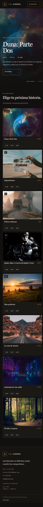
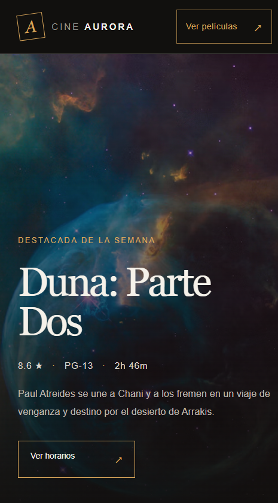
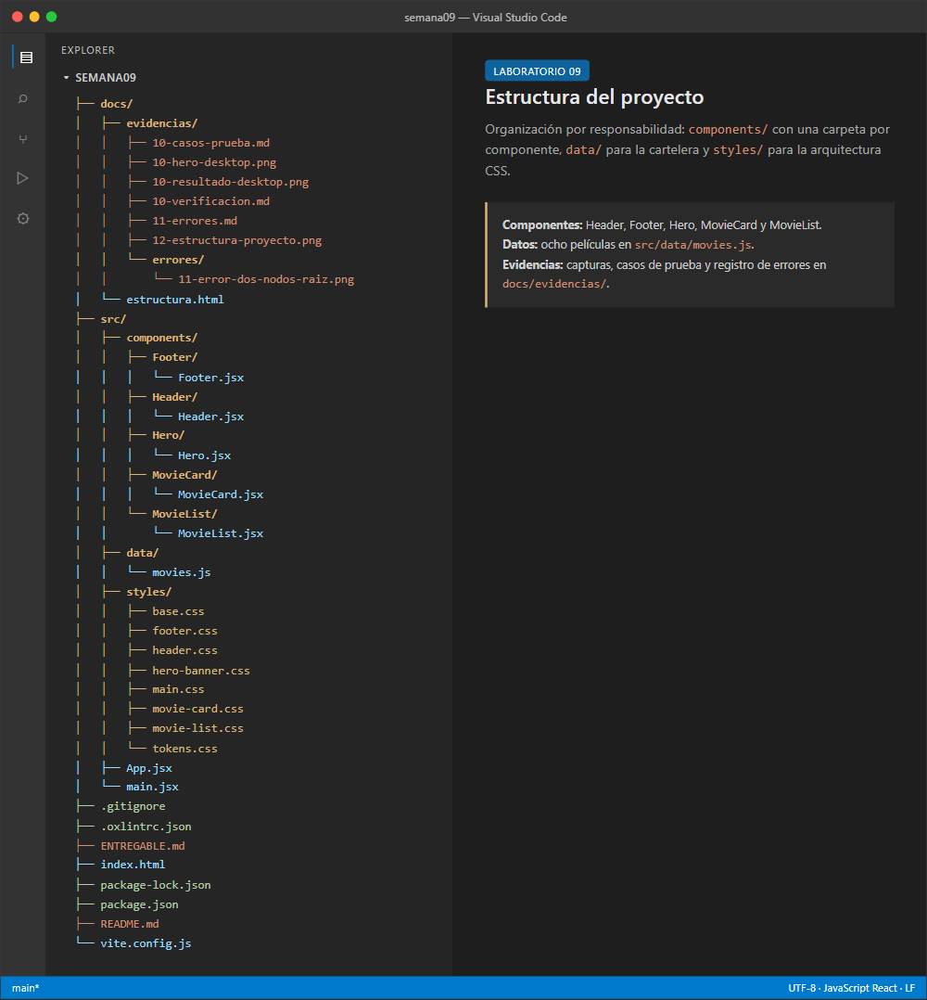
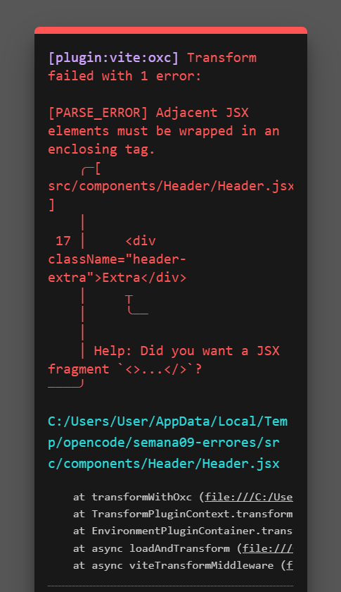

# Laboratorio 09 — Cartelera “Cine Aurora” con React + Vite

## 1. Datos del alumno

| Campo | Valor |
|---|---|
| Nombre | Michael Montgomery Rosell |
| Curso | Desarrollo de Aplicaciones Empresariales |
| Sección | 4-C24-A |
| Laboratorio | Semana 09 — ReactJS |
| Repositorio | https://github.com/mayragarcia-dev/semana09.git |
| Commit final | Rama `main` — consultar con `git log -1 --oneline` |

## 2. Título del desarrollo

**Cartelera “Cine Aurora”: componentes funcionales, composición y props con React + Vite.**

## 3. Resumen del proyecto

Aplicación web de una sola página que muestra la cartelera de un cine. La interfaz se compone de un encabezado con navegación, un banner con la película destacada, una grilla con ocho películas y un pie de página con información de contacto. Los datos viven en un archivo independiente y se distribuyen a los componentes mediante props.

**Tecnologías:** React 19, Vite 8, JavaScript (JSX), CSS modular por responsabilidad y Oxlint.

## 4. Captura del resultado

### Vista completa de la cartelera



### Vista inicial del hero



## 5. Estructura del proyecto



```text
semana09/
├── docs/
│   └── evidencias/
│       ├── 10-casos-prueba.md
│       ├── 10-hero-desktop.png
│       ├── 10-resultado-desktop.png
│       ├── 10-verificacion.md
│       ├── 11-errores.md
│       ├── 12-estructura-proyecto.png
│       └── errores/
│           └── 11-error-dos-nodos-raiz.png
├── src/
│   ├── components/
│   │   ├── Footer/
│   │   │   └── Footer.jsx
│   │   ├── Header/
│   │   │   └── Header.jsx
│   │   ├── Hero/
│   │   │   └── Hero.jsx
│   │   ├── MovieCard/
│   │   │   └── MovieCard.jsx
│   │   └── MovieList/
│   │       └── MovieList.jsx
│   ├── data/
│   │   └── movies.js
│   ├── styles/
│   │   ├── base.css
│   │   ├── footer.css
│   │   ├── header.css
│   │   ├── hero-banner.css
│   │   ├── main.css
│   │   ├── movie-card.css
│   │   ├── movie-list.css
│   │   └── tokens.css
│   ├── App.jsx
│   └── main.jsx
├── .gitignore
├── .oxlintrc.json
├── ENTREGABLE.md
├── index.html
├── package-lock.json
├── package.json
├── README.md
└── vite.config.js
```

La estructura cumple dos criterios del laboratorio:

- **Carpetas por responsabilidad:** `components/`, `data/` y `styles/`.
- **Una carpeta por componente:** cada componente vive en su propia carpeta con su archivo `.jsx`.

## 6. Código

### 6.1. Punto de entrada — `src/main.jsx`

```jsx
import { StrictMode } from 'react'
import { createRoot } from 'react-dom/client'
import './styles/main.css'
import App from './App.jsx'

createRoot(document.getElementById('root')).render(
  <StrictMode>
    <App />
  </StrictMode>,
)
```

### 6.2. Composición principal — `src/App.jsx`

```jsx
import Header from './components/Header/Header.jsx'
import Footer from './components/Footer/Footer.jsx'
import Hero from './components/Hero/Hero.jsx'
import MovieList from './components/MovieList/MovieList.jsx'
import { movies } from './data/movies.js'

export default function App() {
  return (
    <div className="page-shell" id="inicio">
      <Header />
      <main>
        <Hero movie={movies[0]} />
        <MovieList movies={movies} />
      </main>
      <Footer />
    </div>
  )
}
```

### 6.3. Datos de la cartelera — `src/data/movies.js` (extracto)

El archivo contiene ocho películas. Cada objeto incluye `id`, `title`, `image`, `synopsis`, `classification`, `rating`, `duration` y `schedules`.

```js
export const movies = [
  {
    id: 'duna-parte-dos',
    title: 'Duna: Parte Dos',
    image: 'https://images.unsplash.com/photo-1462331940025-496dfbfc7564?auto=format&fit=crop&w=900&q=85',
    synopsis: 'Paul Atreides se une a Chani y a los fremen en un viaje de venganza y destino por el desierto de Arrakis.',
    classification: 'PG-13',
    rating: 8.6,
    duration: '2h 46m',
    schedules: ['13:30', '17:00', '20:30'],
  },
  {
    id: 'oppenheimer',
    title: 'Oppenheimer',
    image: 'https://images.unsplash.com/photo-1485846234645-a62644f84728?auto=format&fit=crop&w=900&q=85',
    synopsis: 'El físico J. Robert Oppenheimer y su equipo desarrollan el proyecto que cambiaría el curso de la historia.',
    classification: 'R',
    rating: 8.3,
    duration: '3h 00m',
    schedules: ['14:00', '18:00', '21:15'],
  },
  // ... six more movies
]
```

### 6.4. Header — `src/components/Header/Header.jsx`

```jsx
import '../../styles/header.css'

export default function Header() {
  return (
    <header className="site-header">
      <a className="brand" href="#inicio" aria-label="Cine Aurora, inicio">
        <span className="brand-mark" aria-hidden="true">A</span>
        <span className="brand-name">CINE <strong>AURORA</strong></span>
      </a>
      <nav className="main-nav" aria-label="Navegación principal">
        <a className="nav-link is-active" href="#peliculas">Cartelera</a>
        <a className="nav-link" href="#proximamente">Próximamente</a>
        <a className="nav-link" href="#experiencia">La experiencia</a>
      </nav>
      <a className="header-cta" href="#cartelera">Ver películas <span aria-hidden="true">↗</span></a>
    </header>
  )
}
```

### 6.5. Footer — `src/components/Footer/Footer.jsx`

```jsx
import '../../styles/footer.css'

const currentYear = new Date().getFullYear()

export default function Footer() {
  return (
    <footer className="site-footer" id="contacto">
      <div className="site-footer__top">
        <a className="brand site-footer__brand" href="#inicio" aria-label="Cine Aurora, volver al inicio">
          <span className="brand-mark" aria-hidden="true">A</span>
          <span className="brand-name">CINE <strong>AURORA</strong></span>
        </a>
        <p>Las historias se disfrutan mejor<br />cuando las compartimos.</p>
        <div className="site-footer__contact">
          <span>VEN A VISITARNOS</span>
          <a href="https://maps.google.com/?q=Av.+Larco+1234,+Miraflores,+Lima">Av. Larco 1234, Miraflores, Lima</a>
          <a href="tel:+5115550123">+51 1 555 0123</a>
          <a href="mailto:hola@cineaurora.pe">hola@cineaurora.pe</a>
        </div>
        <div className="site-footer__hours">
          <span>HORARIOS DE ATENCIÓN</span>
          <p>Lun — Dom<br />12:00 p. m. — 11:00 p. m.</p>
        </div>
      </div>
      <div className="site-footer__bottom">
        <span>© {currentYear} Cine Aurora. Todos los derechos reservados.</span>
        <a href="#inicio">Volver arriba ↑</a>
      </div>
    </footer>
  )
}
```

### 6.6. Hero — `src/components/Hero/Hero.jsx`

```jsx
import '../../styles/hero-banner.css'

export default function Hero({ movie }) {
  if (!movie) return null

  return (
    <section className="featured-hero" id="cartelera" aria-labelledby="featured-title">
      
      <div className="featured-hero__shade" />
      <div className="featured-hero__content">
        <p className="featured-hero__eyebrow">DESTACADA DE LA SEMANA</p>
        <h1 id="featured-title">{movie.title}</h1>
        <p className="featured-hero__meta">{movie.rating} ★ <span>·</span> {movie.classification} <span>·</span> {movie.duration}</p>
        <p className="featured-hero__synopsis">{movie.synopsis}</p>
        <a className="featured-hero__button" href="#peliculas">Ver horarios <span aria-hidden="true">↗</span></a>
      </div>
      <span className="featured-hero__index">CINE AURORA <b>—</b> 01 / 08</span>
    </section>
  )
}
```

### 6.7. MovieCard — `src/components/MovieCard/MovieCard.jsx`

```jsx
import '../../styles/movie-card.css'

export default function MovieCard({ movie }) {
  return (
    <article className="movie-card">
      <div className="movie-card__poster-wrap">
        
        <span className="movie-card__classification">{movie.classification}</span>
      </div>
      <div className="movie-card__body">
        <div className="movie-card__heading">
          <h3>{movie.title}</h3>
          <span className="movie-card__rating" aria-label={`Valoración ${movie.rating} de 10`}>★ {movie.rating}</span>
        </div>
        <div className="movie-card__times" aria-label="Horarios disponibles">
          {movie.schedules.map((time) => <span className="movie-card__time" key={`${movie.id}-${time}`}>{time}</span>)}
        </div>
      </div>
    </article>
  )
}
```

### 6.8. MovieList — `src/components/MovieList/MovieList.jsx`

```jsx
import MovieCard from '../MovieCard/MovieCard.jsx'
import '../../styles/movie-list.css'

export default function MovieList({ movies }) {
  return (
    <section className="movie-list-section" id="peliculas" aria-labelledby="movies-title">
      <div className="movie-list-section__intro">
        <div>
          <p className="movie-list-section__eyebrow">EN CARTELERA</p>
          <h2 id="movies-title">Elige tu próxima historia.</h2>
        </div>
        <p className="movie-list-section__note">Ocho películas. Una sala para cada emoción.</p>
      </div>
      <div className="movie-list">
        {movies.map((movie) => <MovieCard movie={movie} key={movie.id} />)}
      </div>
    </section>
  )
}
```

### 6.9. Arquitectura CSS

`src/styles/main.css` centraliza la carga de estilos:

```css
@import './tokens.css';
@import './base.css';
@import './header.css';
@import './hero-banner.css';
@import './movie-card.css';
@import './movie-list.css';
@import './footer.css';
```

`src/styles/tokens.css` define los tokens visuales:

```css
:root {
  font-family: 'Arial', 'Helvetica Neue', sans-serif;
  color: #f5f1e9;
  background: #11100e;
  font-synthesis: none;
  text-rendering: optimizeLegibility;
  -webkit-font-smoothing: antialiased;
  --color-bg: #11100e;
  --color-panel: #1a1916;
  --color-text: #f5f1e9;
  --color-muted: #9c9991;
  --color-accent: #d9a65a;
  --color-line: rgba(245, 241, 233, .15);
  --font-display: Georgia, 'Times New Roman', serif;
  --page-gutter: clamp(22px, 6.2vw, 96px);
}
```

## 7. Explicación del resultado

### 7.1. Composición de componentes

`App.jsx` es el componente raíz y actúa como orquestador. No contiene la lógica visual de cada sección: solo compone los componentes y les entrega los datos.

```text
App
├── Header          → nombre del cine y navegación
├── main
│   ├── Hero        → película destacada (movies[0])
│   └── MovieList   → cartelera completa (movies)
│       └── MovieCard → una película (movie)
└── Footer          → contacto y horarios
```

Cada componente tiene una responsabilidad:

- **Header:** identidad del cine y navegación.
- **Hero:** banner de la película destacada.
- **MovieList:** recorre la cartelera y dibuja una tarjeta por película.
- **MovieCard:** presenta imagen, título, clasificación, valoración y horarios.
- **Footer:** información de contacto y horarios de atención.

### 7.2. Flujo de props

```text
movies.js
   │
   ▼
App.jsx
   ├── movies[0] ──────────────► Hero
   └── movies ─────────────────► MovieList
                                     │
                                     └── movie ─────► MovieCard
```

Los componentes hijos **no importan** `movies.js`; reciben únicamente los datos que necesitan. Esto cumple el criterio de props del laboratorio y evita duplicar la fuente de datos.

### 7.3. Listas y claves

`MovieList` usa `map` para transformar el arreglo de películas en tarjetas. Cada tarjeta recibe `key={movie.id}`, una clave estable y única. Dentro de `MovieCard`, los horarios también usan una clave compuesta: ``key={`${movie.id}-${time}`}``.

### 7.4. CSS por responsabilidad

La arquitectura CSS separa:

- `tokens.css`: variables de color, tipografía y espaciado.
- `base.css`: reset y estilos globales.
- `header.css`, `hero-banner.css`, `movie-card.css`, `movie-list.css`, `footer.css`: estilos por componente.
- `main.css`: punto único de importación.

## 8. Casos de prueba

El detalle completo está en [`docs/evidencias/10-casos-prueba.md`](docs/evidencias/10-casos-prueba.md).

| ID | Caso | Resultado |
|---|---|---|
| TC-01 | Carga inicial con header, hero, 8 tarjetas y footer | Correcto |
| TC-02 | Título del documento `Cine Aurora — Cartelera` | Correcto |
| TC-03 | Datos desde `movies.js` | Correcto |
| TC-04 | Hero recibe `movies[0]` por props | Correcto |
| TC-05 | Cada `MovieCard` recibe su película por props | Correcto |
| TC-06 | Sin advertencia de `key` en la consola | Correcto |
| TC-07 | Sin advertencia de `className` | Correcto |
| TC-08 | Compilación con `npm run build` | Correcto |
| TC-09 | Lint con `npm run lint` | Correcto |
| TC-10 | Imágenes de la cartelera visibles | Correcto |

**Resumen:** 10 casos ejecutados, 10 correctos, 0 fallidos, 0 errores de consola.

## 9. Errores provocados y aprendidos

El detalle completo está en [`docs/evidencias/11-errores.md`](docs/evidencias/11-errores.md).

| Error | Mensaje exacto | Corrección |
|---|---|---|
| `class` en lugar de `className` | `Invalid DOM property \`class\`. Did you mean \`className\`?` | Usar `className` |
| Dos nodos raíz | `[PARSE_ERROR] Adjacent JSX elements must be wrapped in an enclosing tag.` | Envolver en `<>...</>` o en un contenedor |
| Falta de `key` en el `map` | `Each child in a list should have a unique "key" prop.` | Agregar `key={movie.id}` |

### Evidencia del error de dos nodos raíz



## 10. Observaciones y conclusiones

- La separación en componentes pequeños facilita leer, probar y mantener la interfaz.
- Las props permiten que `Hero`, `MovieList` y `MovieCard` sean reutilizables y no dependan de una fuente de datos concreta.
- `key` no es un detalle opcional: sin ella React no puede reconciliar listas de forma estable.
- JSX exige un único nodo raíz y nombres de propiedades DOM propios de React, como `className`.
- La arquitectura CSS con tokens y archivos por componente mantiene los estilos ordenados y evita un único archivo gigante.
- El proyecto compila y pasa el lint sin errores ni advertencias.

## 11. Autoevaluación de la rúbrica

| Criterio | Puntaje | Evidencia |
|---|---|---|
| 1. Crea el proyecto React con Vite y lo levanta | 5/5 | `npm run dev` activo, `npm run build` exitoso, consola limpia |
| 2. Escribe componentes funcionales con JSX y los compone | 5/5 | `Header`, `Footer`, `Hero`, `MovieCard`, `MovieList` y composición en `App.jsx` |
| 3. Pasa datos del padre a los hijos mediante props | 5/5 | `App → MovieList → MovieCard` y `App → Hero`; sin datos duplicados |
| 4. Entrega el repositorio con la interfaz y observaciones | 5/5 | `ENTREGABLE.md`, `README.md`, capturas, casos de prueba y errores documentados |
| **Total** | **20/20** | |

## 12. Registro de autoría

| Integrante | Tareas realizadas |
|---|---|
| Michael Montgomery Rosell | Configuración del proyecto, componentes, datos, estilos, verificación en navegador, pruebas, documentación y publicación en GitHub |

## 13. Anexos

- [`docs/evidencias/10-verificacion.md`](docs/evidencias/10-verificacion.md)
- [`docs/evidencias/10-casos-prueba.md`](docs/evidencias/10-casos-prueba.md)
- [`docs/evidencias/11-errores.md`](docs/evidencias/11-errores.md)
- [`docs/evidencias/10-resultado-desktop.png`](docs/evidencias/10-resultado-desktop.png)
- [`docs/evidencias/10-hero-desktop.png`](docs/evidencias/10-hero-desktop.png)
- [`docs/evidencias/12-estructura-proyecto.png`](docs/evidencias/12-estructura-proyecto.png)
- [`docs/evidencias/errores/11-error-dos-nodos-raiz.png`](docs/evidencias/errores/11-error-dos-nodos-raiz.png)
